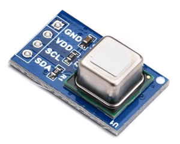
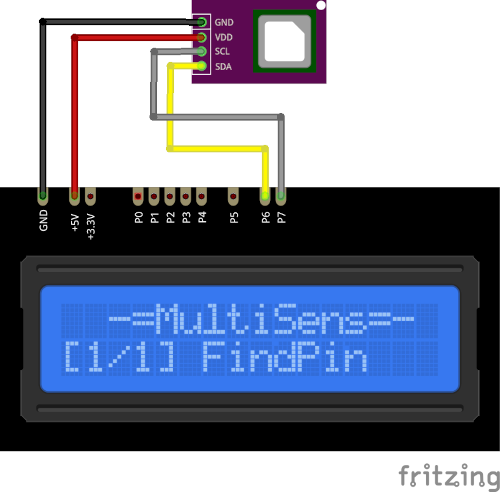

# SCD41 Plugin

The SCD41 plugin recieves CO₂ concentration, temperature and humidity from the SCD41 sensor.

Results are displayed on the device screen and sends to the serial in human-readable and 
Arduino `SerialPlotter` compartible format.

* You can specify the delay between sensors calls using `READ_DELAY_MS` 
  in [plgSCD41.cpp](/src/plgSCD41.cpp)

### Connection

|Sensor Pin|MultiSens Pin|Color|
|:---:|:---:|:---|
|GND|GND|Black|
|VDD|+5V|Red|
|SDA|P6|Yellow-Black|
|SCL|P7|Gray-Black|

                             

[Back to Home](/#supported-devices)

